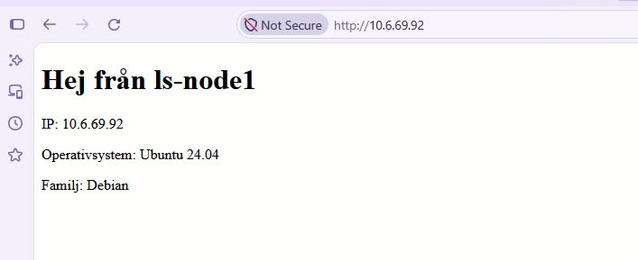

# Lab 6: Dynamiska Konfigurationsfiler med Jinja2 Templates

## Mallen (roles/webserver/templates/index.html.j2)

```html
<!DOCTYPE html>
<html>
<head>
  <meta charset="utf-8">
  <title>{{ ansible_facts['hostname'] }}</title>
</head>
<body>
  <h1>Hej från {{ ansible_facts['hostname'] }}</h1>
  <p>IP: {{ ansible_facts['default_ipv4']['address'] }}</p>
  <p>Operativsystem: {{ ansible_facts['distribution'] }} {{ ansible_facts['distribution_version'] }}</p>
  <p>Familj: {{ ansible_facts['os_family'] }}</p>
</body>
</html>
```

## Uppgiften i rollen webserver

```yaml
- name: Lägg in startsidan från mallen
  ansible.builtin.template:
    src: index.html.j2
    dest: /var/www/html/index.html
  notify: Starta om nginx
```

## Handler (roles/webserver/handlers/main.yml)

```yaml
---
- name: Starta om nginx
  ansible.builtin.service:
    name: nginx
    state: restarted
```

## Resultat i webbläsaren



## Kommando

```bash
ansible-playbook -i inventory.ini site.yml -K
```
