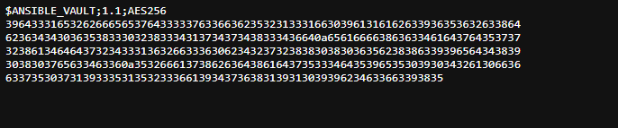
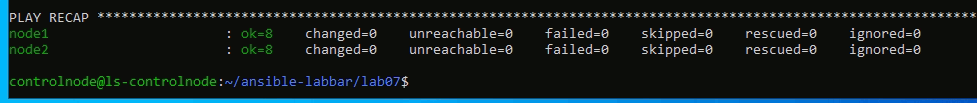
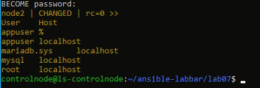

# Lab 7: Secrets Management med Ansible Vault

## Kommando

```bash
ansible-playbook -i inventory.ini site.yml -K --vault-password-file .vault_pass
```

Filen .vault_pass finns inte i repot. Skapa den själv innan du kör:

```bash
echo "DITT_VAULT_LOSENORD" > .vault_pass
chmod 600 .vault_pass
```

## Krypterad variabelfil

Lösenordet ligger i group_vars/all/vault.yml. Filen skapades och krypterades så här, där LOSENORDET byttes mot det riktiga lösenordet:

```bash
mkdir -p group_vars/all
echo "vault_db_password: LOSENORDET" > group_vars/all/vault.yml
ansible-vault encrypt --vault-password-file .vault_pass group_vars/all/vault.yml
```

Filen börjar nu med:

```
$ANSIBLE_VAULT;1.1;AES256
```

## Rollen database

Rollen installerar mariadb-server och python3-pymysql och ser till att MariaDB är igång.

## Databasanvändaren (i site.yml)

```yaml
- name: Databasserver
  hosts: dbservers
  become: true
  roles:
    - database
  tasks:
    - name: Skapa databasanvändaren appuser med lösenordet från vault
      community.mysql.mysql_user:
        name: appuser
        password: "{{ vault_db_password }}"
        state: present
        login_user: root
        login_unix_socket: /run/mysqld/mysqld.sock
      no_log: true
```

## Körning

Utskriften är från en andra körning, därför är allt ok och changed=0.

```
PLAY [Databasserver] ***************************************************************************************************

TASK [Gathering Facts] *************************************************************************************************
ok: [node2]

TASK [database : Installera MariaDB och Pythonbiblioteket för MySQL] ***************************************************
ok: [node2]

TASK [database : Se till att MariaDB är igång och startar vid boot] ****************************************************
ok: [node2]

TASK [Skapa databasanvändaren appuser med lösenordet från vault] *******************************************************
ok: [node2]

PLAY RECAP *************************************************************************************************************
node1                      : ok=8    changed=0    unreachable=0    failed=0    skipped=0    rescued=0    ignored=0
node2                      : ok=8    changed=0    unreachable=0    failed=0    skipped=0    rescued=0    ignored=0
```

## Verifiering

```bash
ansible dbservers -i inventory.ini -b -K --vault-password-file .vault_pass -m command -a "mysql -e 'SELECT user, host FROM mysql.user'"
```

```
node2 | CHANGED | rc=0 >>
User    Host
appuser localhost
mariadb.sys     localhost
mysql   localhost
root    localhost
```

## Hur lösenordet skyddas

- Lösenordet ligger krypterat med AES256 i vault.yml.
- Filen kan bara låsas upp med lösenordet i .vault_pass.
- .vault_pass står i .gitignore och finns bara lokalt, så den hamnar aldrig på GitHub.
- no_log: true gör att lösenordet inte syns i utskriften.

.gitignore i roten av repot:

```
.vault_pass
*.retry
*.log
```

## Skärmdumpar

vault.yml är oläsbar i råformat på GitHub:



Körning med lösenordsfilen:



Databasanvändaren appuser finns:


